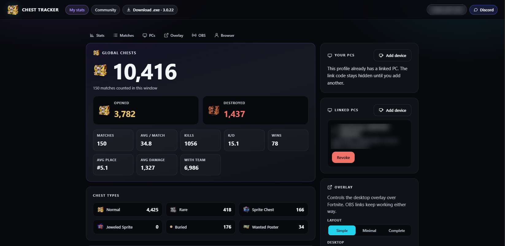
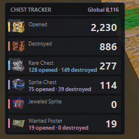
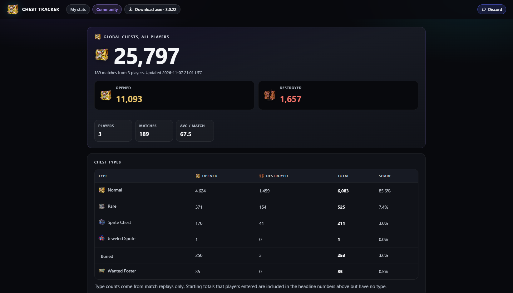

# Chest Tracker

**Count the chests you open and destroy in Fortnite, straight from your match replays.**

Chest Tracker is a small Windows app plus a website with live stats, an OBS overlay and a community total page.

- Website with stats per player, no account and no password
- Windows app (`ChestTracker.exe`) that sends each finished match to the website
- Desktop overlay and a private OBS browser source for streamers
- Public Community page with totals for all players

---

## Important

Replays must be turned on in Fortnite: **Settings → Game → Replays → Record Replays: On** (and Large Team modes if you play them). Without replays, the tool has nothing to read.

Chest Tracker is **PC only** (Windows).

Played a few games before you opened Chest Tracker? It reads those replays from your PC and adds them to your count, as long as replays were turned on before you played them. Games played without replays on cannot be added.

## How it works (and why it is safe)

Fortnite can record a replay of every match on your PC. Chest Tracker reads these replays once the match is over, and nothing else.

- ✅ **Only reads replays:** they are opened read-only and never modified.
- ✅ **No game modification:** nothing in the Fortnite installation folder is touched, no file is added or patched.
- ✅ **No access to the game's memory:** the tool never reads, writes or injects anything into the Fortnite process. It does not interact with the running game at all.
- ✅ **Lightweight:** runs at low priority (and in "efficiency mode" on Windows 11), sleeps between matches, and the overlay is only redrawn when a number changes.

## Getting started

1. Download `ChestTracker.exe` from the website. That single file is all you need.
2. Turn on replays in Fortnite (see above).
3. Run `ChestTracker.exe`.

Windows may show "Windows protected your PC" because the exe is not signed. Click **More info → Run anyway**.

Then open the website, copy your link code and enter it in the app once. Stats appear a few seconds after each match ends.

## Linking your PC

Linking connects the app on your PC to your profile on the website. You only do it once per PC.

1. **Open the website.** Your first visit creates your profile automatically. Under **Link your first PC** you will see a short code (for example `HVKAJQ7A`).
2. **Open `ChestTracker.exe`** on your PC.
3. **Enter the code** when the app asks for it. You can also use the tray menu: right-click the Chest Tracker icon and choose **Link this PC**.
4. **Play a match.** Stats appear on the website a few seconds after the match ends.

Good to know:

- The code is single use and only valid for about 10 minutes. If it expired, reload the website to get a new one.
- Keep the code private. Anyone who enters it in time can add matches to your profile.
- Use the same browser each time. Your profile is remembered by a private cookie in that browser.

### Add another PC

Playing on a second PC? Open your profile on the website, press **Add device** in the **Your PCs** panel, and enter the new code in the app on that PC. Both PCs count towards the same stats.

### Remove a PC

In the **Your PCs** panel, press **Revoke** next to a PC. That PC stops sending matches right away. You can link it again later with a new code.

### Lost your profile (new browser or cleared cookies)

If a PC is still linked, open the Chest Tracker tray menu and choose **Open my stats in browser**. It signs that browser back into your profile. If you lose the cookie and every linked PC, the profile cannot be recovered.

### Already played before linking?

Games you played with replays turned on before you linked are read and added once the app is running. Games played with replays off cannot be added. If you enter a starting total on the website before linking a PC, it is saved and starts counting as soon as a PC is linked.

## Features

- **No sign-up.** The first visit creates an anonymous profile that your browser remembers with a private cookie.
- **Link several PCs.** Each linked PC can be removed at any time.
- **Stats:** Global, Opened and Destroyed chests, chest types, matches, averages, kills, K/D, wins, placement and damage.
- **OBS overlay:** a private, read-only browser source with two styles, chosen on the website (the link never changes):
  - chest icon and Global number
  - text only, for example "Global 1,234 chests"
- **Community page:** totals for all players, with Opened, Destroyed, every chest type and all other chest classes.
- **Discord:** a button in the top right of the site, with a short note on PC only and replays on.

## Overlay and OBS

A desktop overlay shows your numbers over the game: Global, Opened, Destroyed and a count for each chest type. Choose its layout (Simple, Minimal or Complete) on the website. For streaming, add the same numbers to OBS as a private browser source.

 

### OBS setup

1. On the website, open the **OBS** panel and create your private link.
2. In OBS: **Sources → + → Browser**, paste the URL, set the size to about 300 × 100.
3. Pick **Chest icon + number** or **Text only** on the website. OBS updates by itself within a few seconds.

Creating a new link disables the previous one.

## Community page

See how many chests everyone has opened and destroyed. The page shows the Global total, Opened and Destroyed, a table for every chest type, and all other chest classes. It only shows totals, never individual players.

## Privacy

- No accounts, passwords or tracking. Your profile is a random id kept in a private cookie.
- Linked PCs and your OBS link can be revoked at any time.
- The public Community page only shows totals, never individual players.

If you lose the cookie and every linked PC, the profile cannot be recovered.

## Discord

Questions, feedback or bug reports? [Join the Discord](https://discord.gg/BNdbzQY3q).

## License

Add your license here.
